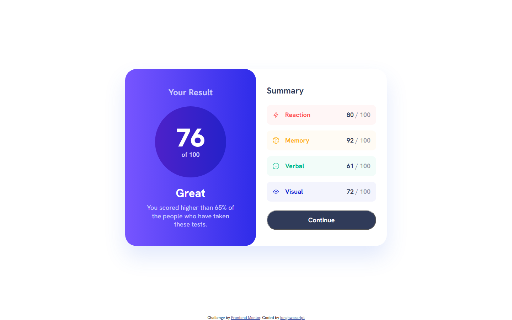

# Frontend Mentor - Results summary component solution

A React implementation of the [Results summary component challenge on Frontend Mentor](https://www.frontendmentor.io/challenges/results-summary-component-CE_K6s0maV).

## Table of contents

- [Overview](#overview)
- [Run locally](#run-locally)
- [My process](#my-process)
- [Author](#author)

## Overview

### The challenge

Build a responsive results card that displays an overall result, a breakdown by category, and a Continue button with hover and keyboard focus styles.

The panels stack on smaller screens and sit side by side from 768px. The four category rows are rendered from [data.json](./data.json). The overall score is fixed at 76 out of 100, and the Continue button currently has no next step.

### Screenshot



### Links

- [Results summary component challenge on Frontend Mentor](https://www.frontendmentor.io/challenges/results-summary-component-CE_K6s0maV)
- [Live site on GitHub Pages](https://jonghwascript.github.io/results-summary-component/)
- [Source code on GitHub](https://github.com/jonghwascript/results-summary-component)

## Run locally

```sh
npm ci
npm run dev
```

To build the project and preview the production output, run:

```sh
npm run build
npm run preview
```

## My process

### Built with

- React and Vite
- Semantic HTML and mobile-first CSS
- CSS custom properties, Flexbox, and Grid
- Locally hosted Hanken Grotesk variable font

### What I learned

- Importing the bundled JSON directly lets the summary render from an array without a runtime request. Each category is passed to a reusable `SummaryItem` and keyed by its category name.
- Vite's `import.meta.glob` resolves the SVG icon URLs so they can be used by the category rows in the production build.
- In the circular score display, Grid's `place-items` centers each line while `place-content` centers both lines together.

### AI collaboration

I used Codex for step-by-step feedback while implementing the React components and for a source-level accessibility review. The review identified low contrast in the category labels and score totals.

## Author

- [@jonghwascript on Frontend Mentor](https://www.frontendmentor.io/profile/jonghwascript)
